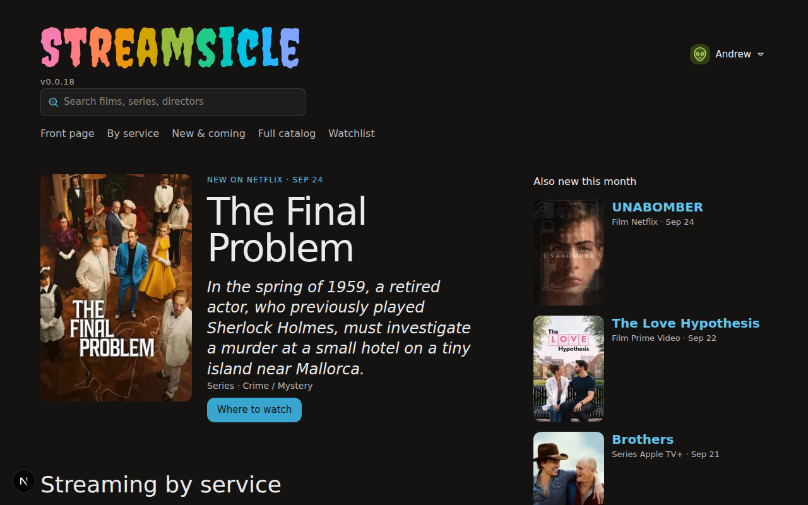

# Streamsicle

A local streaming content ledger for tracking what's available across your family's streaming services.



## Features

- Browse content across Netflix, Prime Video, Disney+, Max, Apple TV+, Hulu, Paramount+, and Peacock
- Tracks streaming, rent, and buy availability per service
- Family profiles with shared watchlist (see who added what)
- Search by title, genre, director, or logline - with automatic TMDB fallback for titles not yet in the catalog
- Track new releases and upcoming titles
- Title details with cast, crew, seasons, episodes, and content ratings (MPAA/TV)
- Popularity rankings from TMDB
- Kid-safe hero: the featured title on the home page is always PG-13 or below
- Optimistic UI: watchlist toggles respond instantly
- Mobile-responsive layout with two-column grids and dedicated mobile header

## Setup

1. **Prerequisites**: Node.js 20+, PostgreSQL 16+
2. **Install dependencies**: `npm install`
3. **Configure environment**: Copy `.env.example` to `.env` and add your [TMDB API key](https://www.themoviedb.org/settings/api)
4. **Create database**: `createdb streamsicle`
5. **Run migrations**: `npx prisma migrate dev`
6. **Seed services**: `npm run seed`
7. **Start dev server**: `npm run dev`

Open [http://localhost:3968](http://localhost:3968).

## Syncing content

Streamsicle pulls its catalog from TMDB in two phases:

### 1. Discover (run once a day)

```bash
npm run sync:discover
```

Fetches every movie and TV show available on your 8 streaming services from TMDB's discover API, including titles available for streaming, rent, and purchase. Saves all title IDs to `data/discovery.json`. Also auto-resolves the latest TMDB provider IDs and updates `src/lib/constants.ts` if they've changed.

### 2. Pull (run anytime)

```bash
npm run sync:pull
```

Reads the cached discovery and pulls title details, cast, crew, content ratings, and service availability into the database. Each title's availability type (stream, rent, buy) is tracked per service. Unchanged titles are detected via sync hash and skipped. Pulls are resumable - if interrupted, running the command again picks up where it left off.

Use `--limit` for a partial pull:

```bash
npm run sync:pull -- --limit 100
```

Use `--full` to force a complete re-pull of all titles:

```bash
npm run sync:pull -- --full
```

After the initial full pull, subsequent pulls are incremental by default - only titles that have changed on TMDB since the last pull are re-fetched.

### Status

```bash
npm run sync:status
```

Shows when the last discovery was run and how many titles are queued.

### Recommended workflow

```bash
npm run sync:discover          # Once a day
npm run sync:pull              # After discovery, or anytime to pick up where you left off
```

The app stays fully usable during a pull - new titles appear as they're synced.

## Search

Search queries the local database first. If fewer than 5 results are found, it automatically falls back to TMDB's multi-search API, imports matching titles on the fly, and returns them alongside local results. Imported titles persist in the database for future searches.

## Stack

- Next.js 16 (App Router) + React 19 + TypeScript
- PostgreSQL + Prisma
- Tailwind CSS
- TMDB API for content data and images
- Phosphor Icons

## Version

v1.0.21
